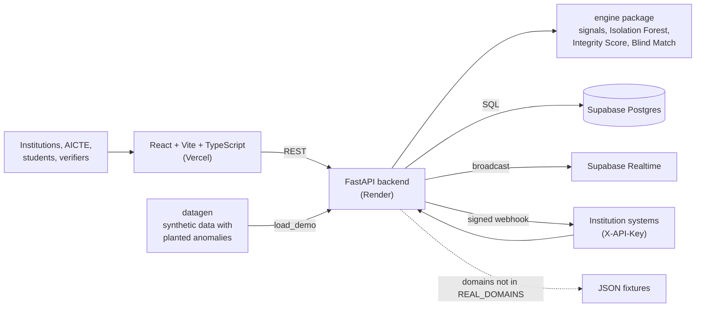

# APAAR Integrity Platform

**One verified ledger of who was admitted where, built on the APAAR ID, that catches over-admission and duplicate or ghost enrolments and lets students prove their enrolment without exposing their identity.**

SIH 2026 · Problem Statement **26263** · AICTE: APAAR ID-based student data management and verification

| | |
| --- | --- |
| Web app | https://apaar-integrity-platform.vercel.app |
| API health | https://apaar-integrity-platform.onrender.com/health |
| API docs | https://apaar-integrity-platform.onrender.com/docs |

> The API runs on Render's free tier. The first request after a quiet spell can take about 30 s while it wakes up.

## The problem

- Institutions admit more students than AICTE approved, and the overrun only shows up long after the fact.
- The same student is enrolled at two institutions, or a "ghost" student fills a seat. Across institutions, nobody sees both records.
- Admissions are backdated to fit within deadlines.
- Students have no trusted way to prove their enrolment to an employer or regulator without handing over their whole record.

## What it does

The app has one screen per role (institution, AICTE, Blind Match, student, verifier). Switch roles from the header.

| Feature | Where a judge sees it |
| --- | --- |
| **Seat Ledger**: approved intake per programme and year, split into seat pools (`regular`, `tfw`, `fn_oci_pio`, `nri`). Each committed admission consumes a seat, and an overrun opens a review case automatically. | Institution dashboard |
| **Upload, validate, commit**: CSV or XLSX upload, suggested column mapping, validation against [`shared/rule-codes.md`](shared/rule-codes.md) (APAAR format, duplicates, unknown programme, invalid dates, admissions after the cutoff), then a single-transaction commit. Rejected rows are fixed by re-uploading corrections. | Institution dashboard → upload wizard |
| **Review and exception queue**: intake overruns, cross-institution duplicates and Blind Match pairs become review cases. AICTE decides each one with a mandatory note. | AICTE dashboard → Exception queue |
| **Integrity Score**: rule signals plus an Isolation Forest anomaly score combine into a 0–100 score per institution. The ranking shows the top signals and an anomaly explanation for each institution. | AICTE dashboard → Integrity Score rankings |
| **Blind Match**: cross-institution fuzzy duplicate detection. Name, DOB and guardian are encoded as keyed (HMAC) Bloom filters, candidates are blocked on a keyed DOB block, and pairs are scored with the Dice coefficient. Only encodings are compared; no raw identity is shared between institutions. | Blind Match screen |
| **Student portal**: the student sees their admissions with a masked APAAR ID and confirms or disputes each one. A dispute opens an AICTE case. The portal also has a consent ledger and an access log showing who looked at the record. | Student screen |
| **APAAR opt-out**: a student without APAAR gets a provisional ID (`PROV-<institution>-<n>`) at upload. This is an info finding, never an error, and never blocks the admission. | Institution dashboard → upload wizard, student registry |
| **Signed credentials**: the student issues an Ed25519-signed credential with only the claims they choose, for one verifier audience, under a per-verifier pseudonym. The credential is shown as a QR code. Verifiers scan or paste it and can verify it offline against the public key. The student can revoke it, and the verifier checks the revocation list. | Student → Share; Verifier screen |
| **Hash-chained audit log**: every state change is chained by hash, and one click recomputes the chain and reports the first broken event. | AICTE dashboard → Audit-chain verification |
| **Submission windows and post-lock edits**: AICTE opens and locks an upload window per academic year. Outside it, uploads are refused with `SUBMISSION_WINDOW_CLOSED`. After lock, changes go through edit requests that AICTE approves or rejects. | Institution dashboard → post-lock edit requests |
| **Institution API keys and signed webhooks**: institution systems upload and commit with `X-API-Key`. The platform sends a `batch.committed` webhook signed with HMAC-SHA256 (`X-Signature`). See [`shared/integration-api.md`](shared/integration-api.md). | API only (`/docs`) |
| **Realtime events**: each commit, new case and decision is broadcast on a Supabase Realtime channel ([`shared/events.md`](shared/events.md)). | Backend broadcast; `scripts.realtime_probe` |
| **Reports**: enrolment report (by state, programme, category or gender) and per-institution accreditation summary, as JSON, PDF or XLSX. | AICTE dashboard → reports |

## Architecture



## Privacy and security by design

- **APAAR is masked everywhere** in API responses (`XXXX-XXXX-1234`).
- **Opting out of APAAR never blocks a student.** They get a provisional ID, and the upload records an info finding, not an error.
- **No Aadhaar is stored or logged.** Phone numbers and emails are HMAC-hashed on arrival and never stored raw.
- **Pseudonymous credentials.** Each verifier sees a different pseudonym and only the claims the student chose to share. Credentials can be revoked.
- **Blind Match is keyed.** Bloom encodings and block keys are made with a server-side secret, so encodings cannot be linked back to identities without that key.
- **Tamper-evident audit.** Audit events are hash-chained, and `GET /audit/verify` detects any edit (demo: `scripts.tamper_demo`).
- **Role scoping.** Institution users see and write only their own institution's rows; `aicte_admin` and `auditor` see everything. Row-level security is enabled on every table, and the database is reached only through the backend.

## Real vs simulated

- **All data is synthetic.** Fixture APAAR IDs start with `9999`; phones are `+9196…`/`+9197…` and emails use `@example.com`.
- **Government systems are simulated.** Anything standing in for APAAR, ABC, DigiLocker or AICTE portal SSO is labelled `SIMULATED` in code, API and UI.
- **Per-domain data source.** `REAL_DOMAINS` decides which domains are served from Postgres. All others fall back to JSON fixtures. Every response carries `X-Mock: true|false`, and the UI shows a `MOCK` badge when the data came from fixtures.
- **Demo login.** `MOCK_MODE=true` lets you pick a role from the header (`X-Demo-Role`). Real Supabase token verification (JWKS ES256/RS256, or HS256) is implemented but switched off for the demo.
- **Live on the deployed site** (from `/health`, 24 Oct 2026):
  - Served from Postgres: `institutions`, `seat_ledger`, `batches`, `admissions`, `review_cases`, `audit`, `submission_windows`, `blind_match`, `students`, `credentials`, `integrity`.
  - Still on fixtures: `reports`, `certificates`.

## Evaluation

### Detection results

Live backend paths, scored against datagen ground truth (`ground_truth.csv`), which the evaluator reads only after predictions are sealed.

| Signal | What it catches | Granularity | Planted cases | TP | FP | FN | Precision | Recall | F1 |
| --- | --- | --- | ---: | ---: | ---: | ---: | ---: | ---: | ---: |
| Intake overrun | Seat pools filled past approved intake | Seat pool | 3 | 3 | 0 | 0 | 1.00 | 1.00 | 1.00 |
| Cross-institution duplicate (same APAAR) | One APAAR ID enrolled at two institutions | Pair | 10 | 10 | 0 | 0 | 1.00 | 1.00 | 1.00 |
| Blind Match (typo duplicates) | Same student re-entered with a name typo and missing or different APAAR | Pair | 12 | 12 | 0 | 0 | 1.00 | 1.00 | 1.00 |
| Shared contact cluster | Many students sharing one phone and email | Record | 16 | 16 | 0 | 0 | 1.00 | 1.00 | 1.00 |
| Backdated admission | Admissions dated before the admission window opened | Record | 16 | 16 | 0 | 0 | 1.00 | 1.00 | 1.00 |

Overall: micro F1 1.00, macro F1 1.00. All 57 planted anomalies found, 0 false alarms.

**Blind Match vs alternatives** (typo duplicates, 12 planted pairs):

| Approach | Precision | Recall | F1 |
| --- | ---: | ---: | ---: |
| Live Blind Match (keyed full-DOB blocking) | 1.00 | 1.00 | 1.00 |
| Blind Match with birth-year blocking | 0.92 | 1.00 | 0.96 |
| Plain-text fuzzy name matching | 0.92 | 1.00 | 0.96 |

Blind Match matches plain-text accuracy without either institution sharing student identity; the live system blocks on a keyed hash of the full date of birth because birth-year blocking let two different students with the same name (born a month apart) score above the threshold, which is the one false positive above.

**Scope**

- Synthetic data with planted anomalies (seed 42, 25 institutions, 5,000 students). This is a benchmark of the detection logic, not a real-world accuracy claim.
- Known limitation: a typo in the date of birth itself puts the two records in different blocks, so that duplicate escapes Blind Match.

**Reproduce** (from the repo root):

```powershell
cd datagen
uv run python generate.py --seed 42 --institutions 25 --students 5000 --out out
cd ..
uv run --project engine python -m engine.evaluation.pipeline datagen/out evaluation/results.json
```

Full method, per-pipeline breakdown and notes: [`evaluation/REPORT.md`](evaluation/REPORT.md).

### Scripted demo: Shadow Institute of Technology

A 75-row upload, loaded by `load_demo`, that should produce exactly:

- one `intake_overrun` case (overrun 11)
- 2 cross-institution duplicate cases
- 1 Blind Match case with Narmada
- a shared-contact cluster of 6
- 3 late admissions
- 2 APAAR opt-outs
- 4 rejected rows

The script exits non-zero if any of these is off. Details: [`backend/scripts/README.md`](backend/scripts/README.md).

## Run locally (PowerShell)

Requirements: Python 3.12 via [uv](https://docs.astral.sh/uv/), Node 20+. Copy the relevant blocks of [`.env.example`](.env.example) into `backend/.env` and `frontend/.env` and fill in your own values. With an empty `REAL_DOMAINS`, everything runs on fixtures without a database.

```powershell
# Backend: http://localhost:8000 (docs at /docs)
cd backend
uv sync
uv run uvicorn app.main:app --reload --port 8000

# Frontend: http://localhost:5173 (in a second terminal)
cd frontend
npm install
npm run dev

# Optional: load the demo dataset into Postgres (needs DATABASE_URL, PSEUDONYM_SECRET, BLIND_MATCH_SECRET)
cd backend
uv run python -m scripts.load_demo --reset --yes
```

`./scripts/dev.ps1` starts backend and frontend together. Tests: `uv run pytest` in `backend/` and `engine/`. More detail is in [`backend/README.md`](backend/README.md).

## Repo layout

| Folder | Contents |
| --- | --- |
| `frontend/` | React + Vite + TypeScript + Tailwind v4 app, one page per role |
| `backend/` | FastAPI service: ingestion, validation, Seat Ledger, review cases, audit chain, credentials, contract export |
| `engine/` | Integrity engine: rule signals, Isolation Forest, Integrity Score, Blind Match, evaluation harness |
| `supabase/` | Postgres migrations and seed data |
| `shared/` | Contracts: CSV templates, rule codes, events, credential and integration specs, OpenAPI and JSON Schemas |
| `datagen/` | Synthetic data generator with planted anomalies and ground truth |
| `reports/` | Report and certificate templates |
| `bot/` | Telegram bot for "Is this you?" confirmations (placeholder) |
| `deck/` | Presentation and demo files |
| `scripts/` | Dev helper scripts |
| `docs/` | Team setup notes |

## Team

| Member | Role | GitHub |
| --- | --- | --- |
| Dev A | Integrity engine, Integrity Score and Blind Match | [@chinmay161](https://github.com/chinmay161) |
| Dev B | Backend, database, contracts, bot | [@Soumya-Vinod](https://github.com/Soumya-Vinod) |
| Dev C | Synthetic data, reports and certificates | [@saachijo14](https://github.com/saachijo14) |
| Dev D | Institution, AICTE and Blind Match screens | [@annieoverthere](https://github.com/annieoverthere) |
| Dev X | Student and verifier screens, deck | [@bhumit1204](https://github.com/bhumit1204) |

## Contributing

Team rules are in [`AGENTS.md`](AGENTS.md). After cloning, enable the commit-message hook once:

```sh
git config core.hooksPath .githooks
```
